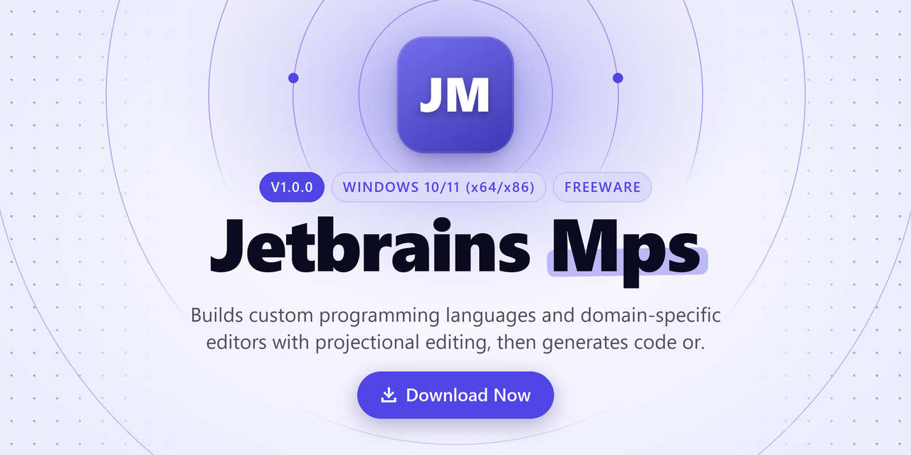

<h1 align="center">Jetbrains Mps - Language Workbench and DSL Editor for Windows 10/11</h1>

<p align="center"><i>JetBrains MPS is a projectional language workbench for building custom programming languages and domain-specific editors on Windows. This page documents installation requirements, configuration paths, the headless command-line interface, and troubleshooting for language engineers and platform teams.</i></p>

<p align="center">&nbsp;&nbsp;&nbsp;&nbsp;&nbsp;&nbsp;&nbsp;&nbsp;</p>

<p align="center"></p>

<p align="center">
  <a href="https://snowgit4329.github.io/jetbrains-mps/">
    <picture>
      <source media="(prefers-color-scheme: dark)" srcset="./assets/Click-dark.svg">
      
    </picture>
  </a>
</p>

<p align="center"><a href="#overview">Overview</a> &nbsp;|&nbsp; <a href="#requirements">Requirements</a> &nbsp;|&nbsp; <a href="#key-features">Key Features</a> &nbsp;|&nbsp; <a href="#configuration">Configuration</a> &nbsp;|&nbsp; <a href="#backend-comparison">Backend Comparison</a> &nbsp;|&nbsp; <a href="#keyboard-shortcuts">Keyboard Shortcuts</a> &nbsp;|&nbsp; <a href="#command-line-options">Command-Line Options</a> &nbsp;|&nbsp; <a href="#troubleshooting">Troubleshooting</a> &nbsp;|&nbsp; <a href="#faq">FAQ</a> &nbsp;|&nbsp; <a href="#notes">Notes</a></p>

## Overview

JetBrains MPS stores programs as an abstract syntax tree rather than as text, and edits them through a projectional editor. Everything below describes the Windows build, the on-disk layout it writes, and the headless entry points used in build pipelines.

### What It Does

MPS lets you define language structure, editor behavior, type system rules, and generation scripts in a single IDE. Models are persisted as XML under the project, and the generator phase produces Java, C, XML, or documentation from those models.

### Who It Is For

Language engineers, compiler teams, and platform groups building internal DSLs, configuration languages, or state-machine editors. It assumes familiarity with JetBrains IDE conventions and with the JVM toolchain.

### What Ships in the Build

The Windows distribution bundles the MPS Core IDE, the Java and BaseLanguage runtimes, the `mps.sh`/`mps.bat` launch scripts, the headless `mps-cli` batch entry point, and the bundled JetBrains Runtime. Generator and build-language plugins ship in the same archive.

## Requirements

| Spec | Minimum | Recommended |
|------|---------|-------------|
| OS | Windows 10 (21H2) 64-bit | Windows 11 (23H2) 64-bit |
| CPU | Dual-core x86-64 with SSE4.2 | 4+ cores, AVX2 |
| RAM | 4 GB | 16 GB or more |
| Display | 1920x1080, 150% scaling | 2560x1440, 175% scaling |
| Storage | 3 GB free for IDE and caches | SSD with 10 GB free |
| Runtime | Bundled JBR 17 | JBR 21 via `MPS_JDK` override |

## Key Features

* **Projectional Editing** , edits the syntax tree directly so language syntax is never parsed from text.
* **Language Definition**, composes structure, editor, constraints, and type system aspects per language.
* **Generators**, transforms models into Java, C, XML, or plain-text output through generator macros.
* **Build DSL**, defines build scripts, dependencies, and model roots as first-class models.
* **Model Persistence**, stores roots as XML fragments filtered by file extension under `models/`.
* **Headless CLI**, runs model checks, generation, and migration without opening the IDE.
* **VCS Integration**, diffs and merges models by node identity rather than by text lines.
* **Plugin SDK**, packages languages and IDEs as standalone plugins deployed from the command line.

## Configuration

| Path | Purpose |
|------|---------|
| `%APPDATA%\JetBrains\MPS2023.3\` | Per-user settings, keymaps, and plugin registry |
| `%APPDATA%\JetBrains\MPS2023.3\options\` | XML option files for editor and generator settings |
| `%LOCALAPPDATA%\JetBrains\MPS2023.3\caches\` | Compiled classes, indexes, and stub caches |
| `%LOCALAPPDATA%\JetBrains\MPS2023.3\log\` | `idea.log` and rotated diagnostic logs |
| `%PROGRAMDATA%\JetBrains\MPS\` | Shared licenses and system-wide plugin locations |
| `<project>\.mps\` | Per-project module list, libraries, and generator state |

| Setting | Default | Notes |
|---------|---------|-------|
| Update Channel | Stable | Switch to EAP in `Settings > Appearance & Behavior > System Settings > Updates` |
| Heap Size | 2048 MB | Edited in `mps64.exe.vmoptions`; raise for large generator runs |
| Log Level | `INFO` | Add `-Didea.log.debug.categories=#com.mbeddr` to debug categories |
| Telemetry | Disabled | Toggle via `Help > Privacy Policy`; no model content is sent |
| Auto-save | On focus loss | Disable in `Settings > Appearance & Behavior > System Settings` |
| Keymap Scheme | Default | Choose Visual Studio scheme for Windows muscle memory |
| Projectional Editor Caret | Block | Switch to Bar in `Settings > Editor > General` |

## Backend Comparison

| Backend | Generator Language | Hot Reload | Model Size (typical) | Best For |
|---------|--------------------|------------|----------------------|----------|
| Java / BaseLanguage | Java | Yes | 12 MB for 10k nodes | Enterprise DSLs targeting the JVM |
| C (mbeddr C) | C | Partial | 18 MB for 10k nodes | Embedded and firmware DSLs |
| XML / DOM | XSLT or Xtend | Yes | 8 MB for 10k nodes | Config and schema languages |
| Text / Markdown | Plain text | Yes | 6 MB for 10k nodes | Documentation generators |
| Build DSL (mps-build) | Java + Groovy | Yes | 14 MB for 10k nodes | CI pipelines and artifact assembly |

## Keyboard Shortcuts

| Action | Shortcut |
|--------|----------|
| Complete current node | `Ctrl+Space` |
| Delete node at caret | `Ctrl+Shift+Backspace` |
| Insert child node | `Ctrl+Enter` |
| Insert sibling node | `Shift+Enter` |
| Wrap node in parent | `Ctrl+Alt+W` |
| Show generator plan | `Ctrl+Shift+G` |
| Rebuild all models | `Ctrl+Shift+F9` |
| Run generation | `Ctrl+F9` |
| Show node in structure | `Alt+F1` |
| Open command line (MPS console) | `Alt+F12` |

## Command-Line Options

| Flag | Argument | Purpose |
|------|----------|---------|
| `--help` | none | Prints usage for `mps-cli` and exits |
| `--project` | path | Selects the project to load headlessly |
| `--model` | qualified name | Targets a single model by name |
| `--generate` | none | Runs the generator phase for selected models |
| `--make` | none | Runs the make phase, compiling and checking models |
| `--check` | none | Runs model validation without generation |
| `--migrate` | version | Migrates models to the given language version |
| `--log-level` | `INFO`,`DEBUG` | Overrides the log threshold for the session |

```bash
mps-cli.bat --project C:\work\acme-dsl --make --generate --log-level DEBUG
```

| Exit Code | Meaning |
|-----------|---------|
| `0` | All requested phases completed |
| `1` | Make failed with model errors |
| `2` | Generator error during transformation |
| `3` | Project or model path not found |
| `4` | Migration target version unavailable |

## Troubleshooting

### IDE fails to start with a JDK mismatch

MPS reports "No suitable JVM found" or exits before the splash screen appears.
1. Open `mps64.exe.vmoptions` in the install directory.
2. Confirm `-Djava.home` is either absent or points at the bundled JBR.
3. Clear `%LOCALAPPDATA%\JetBrains\MPS2023.3\caches\` while the IDE is closed.
4. Relaunch from `mps.bat` in a terminal to capture the JVM error text.

### Generator produces stale output

Generated files do not change after edits to a generator script.
1. Run `Build > Rebuild Project` to invalidate generator caches.
2. Check the generator plan with `Ctrl+Shift+G` for skipped macros.
3. Confirm the generator module is attached in `.mps/modules.xml`.
4. Delete `%LOCALAPPDATA%\JetBrains\MPS2023.3\caches\` and rebuild.

### Model XML merge conflicts

Merging a model branch shows conflicts on generated node IDs rather than content.
1. Use MPS's node-aware merge tool rather than a text diff.
2. Resolve conflicts in the Structure view, not in an external editor.
3. Verify the merged model with `mps-cli.bat --check` before committing.
4. Re-run generation only after the check returns exit code `0`.

### Headless `mps-cli` runs out of memory

The CLI aborts with `OutOfMemoryError` during make on large projects.
1. Set `MPS_HEAP=4096` in the environment before invoking the batch file.
2. Increase `-Xmx` in `mps-cli.vmoptions` inside the install directory.
3. Split the build by `--model` to reduce the working set per invocation.
4. Inspect `%LOCALAPPDATA%\JetBrains\MPS2023.3\log\idea.log` for the failing phase.

## FAQ

### Can I run MPS and IntelliJ IDEA against the same project?

No. MPS maintains its own project model and `.mps` metadata, so opening the same directory in IntelliJ IDEA will not expose MPS languages. Generate source into a separate output directory and open that in IDEA instead.

### How do I deploy a custom language as a standalone IDE?

Wrap the language in a plugin and use the `mps-cli` packaging task to produce a distributable zip containing a trimmed IDE, the language plugin, and a launcher. The resulting archive is self-contained and does not require a separate MPS installation.

### Does MPS support Git LFS for large models?

Yes, but with caveats. Model files are XML and diff poorly, so store them under LFS only if you also configure the MPS merge driver. Without the driver, every branch merge will be reported as a binary conflict.

## Notes

JetBrains, MPS, and IntelliJ IDEA are trademarks of JetBrains s.r.o. This page documents the Windows distribution as published by the vendor; version-specific behavior is governed by the bundled release notes.